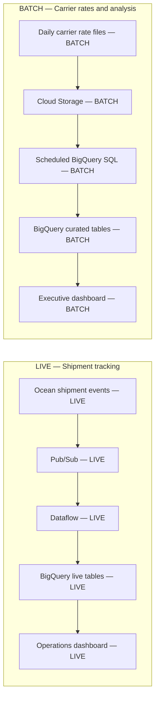

# Alpine Outdoor — Data Platform Architecture

**Customer:** SHP01 — Alpine Outdoor  
**Architecture:** Cost-conscious Lambda architecture  
**Freshness target:** 15 minutes  
**Reliability target:** At least 55% on time on every lane  
**Budget:** $20 per month  
**Transport mode:** Ocean only

## Architecture diagram

## Design decisions

1. Shipment tracking events use the live path to support the 15-minute freshness target.
2. Daily carrier rate files use batch processing because they do not require real-time processing.
3. Pub/Sub is selected as the message broker; Kafka is excluded to avoid duplicate messaging infrastructure.
4. Scheduled BigQuery SQL is preferred over Dataproc for the initial batch workload to reduce complexity and potential costs.
5. Only ocean freight shipments relevant to Alpine Outdoor are included.
6. BigQuery stores live operational data separately from curated analytical data.

## Cost and reliability considerations

- Keep the live pipeline small and monitor its resource usage.
- Use scheduled batch processing for daily rate files.
- Monitor BigQuery storage and query costs against the $20 monthly budget.
- Track on-time performance for all four shipping lanes.
- Investigate carriers that underperform the 55% reliability target.

**Important:** The $20 budget must be validated against actual Google Cloud usage.
